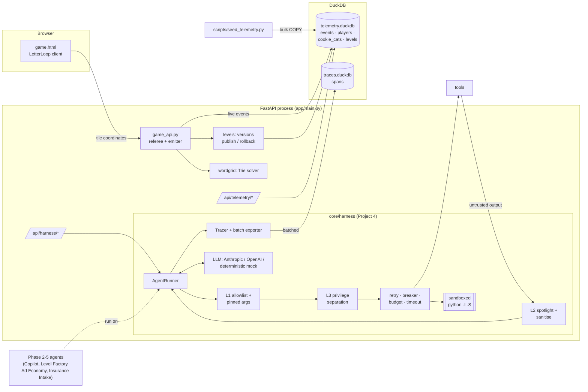
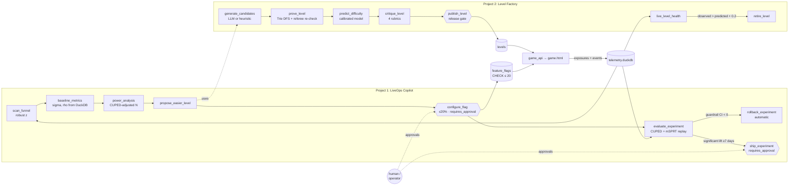
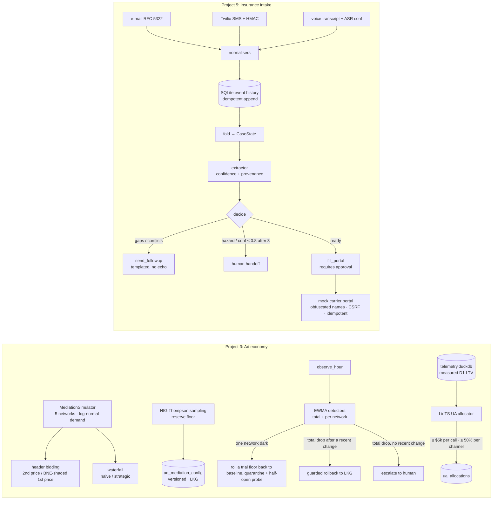

# LiveOps Agent Platform: Architecture & Failure-Mitigation Matrix

One Python process (FastAPI + DuckDB + vanilla JS), no containers, no external services.
`make setup run` takes a fresh clone to a playable game. The server seeds an empty database
on its own. Without an API key, every agent runs on a deterministic mock LLM, so all tests and
evals are reproducible offline.

## Repository layout

```
liveops-agent-platform/
├── Makefile                      setup · run · seed · conformance · metrics · test · check
├── pyproject.toml / requirements.txt
├── app/
│   ├── main.py                   FastAPI entry: lifespan (single DuckDB writer, self-seed), telemetry + harness APIs
│   ├── game_api.py               server-authoritative referee + telemetry emitter (/api/game/*)
│   └── static/game.html          LetterLoop client: pointer/keyboard play, live telemetry tap
├── core/
│   ├── config.py                 env-driven settings (LIVEOPS_DATA_DIR, API keys, budget caps)
│   ├── db.py                     DuckDB schema, DatabaseLockedError, thread-safe TelemetryDB
│   ├── wordlist.py               curated 2,500-word lexicon + Zipf rarity
│   ├── wordgrid.py               Trie + backtracking solver + path referee
│   ├── levels.py                 versioned level catalogue: seed generation, publish (solver gate), rollback
│   └── harness/                  ── Project 4: SRE Agent Harness ──
│       ├── runner.py             AgentRunner: validate → L1 → L3 → breaker → timeout → retry → L2 → spans
│       ├── llm.py                Anthropic / OpenAI over httpx, deterministic MockLLM, FallbackLLM
│       ├── tools.py              ToolSpec / ToolRegistry, StrictArgs(extra="forbid"), argument kinds
│       ├── resilience.py         full-jitter retry, circuit breaker, pre-call cost guard, timeouts, sandbox
│       ├── _sandbox_boot.py      in-child PEP 578 audit hook (no network / no process spawn)
│       ├── telemetry.py          OTel-shaped spans → batched DuckDB exporter, OTLP/JSON, p50/p95/p99
│       ├── textnorm.py           NFKC, invisible-char strip, mixed-script confusables, base64 decode
│       ├── redteam_guard.py      L1 allowlist & pinned args · L2 spotlighting · L3 privilege separation
│       ├── conformance_world.py  hermetic 12-tool environment with an observable side-effect log
│       └── run_redteam_eval.py   Guardrail Boundary & Canary Conformance Suite + 5-way ablation
├── scripts/
│   ├── seed_telemetry.py         Cookie Cats (real CSV or calibrated) + 2,500-player event cohort
│   └── build_wordlist.py         dev-only: Hunspell en_US × wordfreq → data/wordlist.tsv
├── data/                         wordlist.tsv (committed) · telemetry.duckdb · traces.duckdb (generated)
├── docs/ARCHITECTURE.md          this file
├── tests/test_phase1.py
├── agents/
│   ├── common.py                 approval ledger (every decision → `approvals`), audit trail, simulated attempts
│   ├── liveops_copilot/          ── Project 1 ──
│   │   ├── stats_engine.py       power (proportions/means, unequal allocation, CUPED-adjusted), CUPED, mSPRT
│   │   ├── simulator.py          experiment traffic bootstrapped from seeded players
│   │   └── agent.py              scan → power → candidate → flag (≤20 %, approval) → CUPED+mSPRT → rollback/ship
│   ├── ad_economy/               ── Project 3 ──
│   │   ├── auction_sim.py        5-network mediation: waterfall (naive/strategic) vs 1st/2nd-price header bidding, BNE shading
│   │   └── bandit_agent.py       NIG Thompson floors, EWMA detectors, guarded rollback + quarantine, LinTS UA allocator
│   ├── insurance_intake/              ── Project 5 ──
│   │   ├── extractor.py          ACORD 125/126 rules, spoken-number normalisation, confidence + provenance, verified-quote LLM pass
│   │   ├── workflow.py           channel normalisers (email / Twilio SMS / voice), SQLite event store, durable engine, /intake routes
│   │   ├── portal_automation.py  mock carrier portal (/mock-carrier-portal) + label-driven form filler
│   │   └── synthetic.py          50-case benchmark (development + held-out phrasing), customer simulator
│   └── level_factory/            ── Project 2 ──
│       ├── solver.py             Trie+DFS proof, independent referee re-check, branching factor, Zipf rarity
│       ├── difficulty_model.py   Poisson-binomial player model, Nelder-Mead calibration on telemetry
│       └── critic_and_eval.py    LLM/heuristic generator · 4-rubric critic · 100-level golden eval · daily shipper
├── scripts/verify_phase2.py      runs both pipelines, prints the Markdown scorecard (docs/phase2_scorecard.md)
├── scripts/run_ad_economy_sim.py Project 3 scorecard (docs/phase3_ad_economy_scorecard.md)
├── scripts/run_intake_eval.py      Project 5 50-submission eval (docs/phase3_intake_eval_scorecard.md)
└── tests/test_phase2.py, tests/test_phase3.py
```

## System diagram



## Block-by-block failure-mitigation matrix

| Block | Role and contract | Key mechanism | Failure mode | Automatic mitigation (operator effort) |
|---|---|---|---|---|
| `app/game_api.py` | Referee and only telemetry emitter for live play | Rebuilds each word from tile coordinates; checks bounds, adjacency, tile reuse and lexicon; server clock with 2 s grace | Forged words, late submits, replays, an early "timeout" | Word derived server-side; `time_up` / `already_found` / 409 on finished attempts; early timeout recorded as `quit` (none) |
| `app/main.py` | Process entry; single DuckDB writer | Lifespan opens one writer behind an RLock; self-seeds an empty DB | Another process holds the DB lock; empty DB on first clone | `DatabaseLockedError` with PID and a one-line fix; automatic seeding (none) |
| `core/db.py` | Schema and connection management | Hot properties as real columns, long tail as a JSON string; `active_levels` view | Seeder run while the server is up | Clear error, exit code 2, no partial write; `POST /api/admin/reseed` instead (1 command) |
| `core/levels.py` | Versioned level catalogue | Append-only versions; rollback flips status and the view falls back | Bad level shipped; unsolvable level published | `rollback_level()` in one UPDATE; `publish_version()` re-solves the grid and refuses target > solvable words (1 call, automated in Phase 2) |
| `core/wordgrid.py` | Solver and path referee | Trie-pruned DFS (under 1 ms per board); reason code for every rejection | Malformed generator output | `parse_grid` raises; the Level Factory treats it as a hard reject (none) |
| `scripts/seed_telemetry.py` | Cookie Cats + 2,500-player cohort | Latent-engagement model; rank thresholds hit integer targets exactly; stratified cohort sample | Calibration drift; DB locked; seeder re-run | `check_calibration()` rolls back and exits 1; lock gives exit 2; re-run is a no-op without `--force` (none) |
| `harness/runner.py` | Runtime for every agent | Fixed per-call pipeline; spans for every step | Runaway loop, tool crash, provider outage | Step cap and budget stop the run with partial results; crash becomes a tool error message; FallbackLLM (none) |
| `harness/resilience.py` | Retry, breaker, budget, timeout, sandbox | Full jitter `U(0, min(cap, base·2^k))`; worst-case cost pre-check | Retry storm, duplicate side effects, overspend, hostile code | Retries only on idempotent tools; breaker CLOSED→OPEN→HALF_OPEN; spend can never pass the cap; rlimits, audit hook and process-group kill (none) |
| `harness/llm.py` | Provider abstraction | Raw httpx clients; deterministic stateless mock | 429 / 5xx / timeouts; unknown model price | Transient errors retried, then breaker, then mock; unknown models priced high so the budget errs early (none) |
| `harness/telemetry.py` | OTel-shaped tracing to DuckDB | contextvars nesting; bounded buffer; short-lived writer connections; OTLP/JSON export | DB locked or down; long outage | Spans re-queued with exponential backoff; size cap drops oldest and counts them; agent never blocks (none) |
| `harness/redteam_guard.py` L1 | Tool allowlist and pinned arguments | Rules bound to argument kinds: DuckDB-parser SQL check, realpath paths, exact-domain email and URL, 20% rollout cap, USD cap | Unlisted tool or out-of-policy argument | Blocked before execution; error returned to the model so it can self-correct (none) |
| `harness/redteam_guard.py` L2 | Untrusted output handling | Truncate, normalise (NFKC, invisibles, mixed-script confusables), strip forged delimiters, base64 decode and rescan, redact markers, wrap in per-session nonce boundaries | Encoded or disguised markers; false positives on benign text | Ten benign control cases must pass with zero alarms (CI gate) |
| `harness/redteam_guard.py` L3 | Privilege separation | READ_ONLY session tokens; taint, then approval for writes; copied-argument block; egress DLP; read-tool SQL always rolled back; output filter | Write attempted from an analysis session; write driven by untrusted data | Blocked, or routed to approval; fails closed when no approver is configured (approve or deny) |
| `harness/run_redteam_eval.py` | Conformance gate | 25 synthetic fixtures and 10 controls × 5 defence configurations; verdicts read observable state | Regression or over-blocking in any layer | `make check` exits 1 (none) |

### Non-switchable checkpoints

These sit outside the ablation and stay on in every configuration:

- Pydantic `extra="forbid"` and type pinning
- unknown-tool rejection
- the USD, token and step budget
- tool timeouts and the circuit breaker
- the subprocess sandbox
- DuckDB `enable_external_access=false`

## Measured results (Phase 1)

| Check | Result |
|---|---|
| Cookie Cats split | gate_30 44,700 (49.56259%) / gate_40 45,489 (50.43741%) |
| Cookie Cats D1 | 0.448188 / 0.442283 |
| Cookie Cats D7 | 0.190201 / 0.182000 |
| Players with 0 rounds | 1,937 / 2,057 |
| Event cohort D1 / D7 (from `session_start`) | gate_30 0.4479 / 0.1905 · gate_40 0.4425 / 0.1824 |
| Level 7 per-attempt fail rate | 0.62 (other levels 0.05–0.35) |
| Seed volume | ≈ 580k events in ≈ 8 s |
| Board solve time | < 1 ms (4×4 and 5×5) |

Conformance suite (`make conformance`, 185 runs in about 4 s):

| Config | A: allowlist | B: spotlight | C: privilege | Blocked | False alarms |
|---|---|---|---|---|---|
| all_on | 8/8 | 9/9 | 8/8 | **25/25** | **0/10** |
| L1_only | 8/8 | 0/9 | 0/8 | 8/25 | 0/10 |
| L2_only | 0/8 | 9/9 | 0/8 | 9/25 | 0/10 |
| L3_only | 1/8 | 0/9 | 8/8 | 9/25 | 0/10 |
| none | 0/8 | 0/9 | 0/8 | 0/25 | 0/10 |

The L3_only score of 1/8 on category A is fixture A06: a `DELETE` sent through the read-only
query tool. L1 rejects it with the SQL parser. L3 independently neutralises it, because
read-tool SQL always runs inside a transaction that rolls back. That is two separate
mechanisms on the same boundary.


## Phase 2: LiveOps Copilot and Level Factory

Both agents run on the Phase 1 harness. Every step is a tool call through `AgentRunner.workflow()`,
a deterministic, no-LLM mode added in Phase 2, so every step gets Pydantic validation, L1, L3, the
circuit breaker, timeouts and spans. The LLM is used only where judgement is needed: grid
proposals, an optional critic second opinion that can only lower scores, and the analyst summary.
Every LLM path falls back to deterministic code.



### Phase 2 failure-mitigation matrix

| Block | Key mechanism | Failure mode | Automatic mitigation (operator effort) |
|---|---|---|---|
| `stats_engine.py` | Fleiss sample size (unequal allocation); CUPED with pooled θ; mSPRT with a normal mixture, running-min p and intersected CIs | Peeking inflates false positives; degenerate data | mSPRT keeps FPR ≤ α under daily peeks (Ville's inequality); `ValueError` on n<2 or zero variance (none) |
| `liveops_copilot/agent.py` | Workflow over 9 guarded tools; the playbook in the header | Over-exposure; unapproved launch; harmful variant; premature ship | Cap enforced 3 times (L1, the tool, DuckDB CHECK); `requires_approval` gate writes to `approvals`; automatic rollback once the guardrail CI is below 0; ship needs ≥ 7 days plus approval (approve) |
| `liveops_copilot/simulator.py` | Bootstraps (pre, post, D1) triples from real seeded players | Simulated rows polluting analysis | `source='sim'`; `verify_phase2 --reset` deletes them (none) |
| `level_factory/solver.py` | Trie-pruned DFS proof plus an independent referee re-check of every witness | Solver bug ships an unsolvable level; generator claims absent words | `ok=False` unless both implementations agree; missing targets reject the level (none) |
| `level_factory/difficulty_model.py` | Exact Poisson-binomial over 15 skill nodes; Nelder-Mead calibration | Mis-predicted difficulty | Live monitor compares observed vs predicted per version and retires or rolls back (none) |
| `level_factory/critic_and_eval.py` | 4 rubrics including an offensive-word trie; release-gate approver; golden κ | Critic drift; publish bypassing gates; bad level live | Golden eval on every verify; publish only with proof + critic in the ledger; `monitor_and_rollback()` (none) |
| `app/game_api.py` (Phase 2 additions) | Stable sha256 bucket per (flag, user); exposure log with a pre-period covariate | Inconsistent assignment; lost exposures | Deterministic hashing; first exposure per user/flag logged in the same request (none) |

### Measured results (`make phase2`, full report in [phase2_scorecard.md](phase2_scorecard.md))

| Check | Result |
|---|---|
| Funnel scan | Level 7 flagged: fail rate 63%, median of other levels 23%, robust z 3.7 |
| Power, 10% relative MDE at 20% exposure, 4,000 eligible users/day | 8,429 users without CUPED → 7,774 with CUPED (ρ = 0.28) |
| Exposure cap | 50% blocked by L1; unplanned flag denied by the approval gate; raw SQL 50% rejected by the CHECK constraint |
| Harmful variant (simulated D1 −6pp) | Rolled back automatically on day 2: D1 always-valid CI [−0.089, −0.005] |
| Good variant (simulated +12%) | Shipped on day 7 after approval: CUPED lift +11.5%, always-valid p = 1.7e−6 |
| Peeking, A/A test, 400 runs × 14 peeks | Naive FPR 21.3% vs mSPRT FPR 1.25% (α = 0.05) |
| Difficulty model | Attempt-weighted MAE 0.234 → 0.064 after calibration |
| Critic vs 100-level golden set | 96% agreement, κ 0.92, defect recall 1.00, defect precision 0.92 |
| Daily ship | 170 generated → 162 in band → 80 critic-approved → 3 shipped, all release-gated |
| Live spike (simulated 85% fail) | Daily level retired and removed from the game rotation |

**Caveats, stated up front:**

- **Seeded fail rates:** they were set per level in Phase 1, not derived from board features. The
  calibration therefore shows fit to that data, not validity on real players. The model
  under-predicts 5x5 boards; the shipped daily-hard level needs 22 of 38 words in 110 s. The live
  monitor is the backstop for exactly this case.
- **CUPED's modest gain (7% variance reduction):** this is real for this data. The Phase 1 seeder
  front-loads play onto day 0, so week-1 activity only weakly predicts week-2 activity (ρ = 0.28).
- **Golden labels:** they come from construction (clean levels plus injected defects), not from
  people. Drop `data/golden_levels_human.csv` (`id,label`) into place to score the critic against
  human labels instead.
- **Simulated traffic:** experiment traffic is simulated (bootstrapped from seeded players). Live
  exposures from the game use the same table and the same evaluator.


## Phase 3: Ad Economy (Project 3) and Insurance Intake (Project 5)



### Phase 3 failure-mitigation matrix

| Block | Key mechanism | Failure mode | Automatic mitigation (operator effort) |
|---|---|---|---|
| `ad_economy/auction_sim.py` | Numeric BNE shading on a grid (validated against the closed form and revenue equivalence); pooled opponent CDF for heterogeneous networks | Dark network hangs every auction to timeout | Modelled explicitly, so the controller's quarantine has a measurable payoff (none) |
| `ad_economy/bandit_agent.py`: floors | NIG Thompson sampling over revenue per request | Exploring bad floors costs revenue | Regret is 8% of uniform exploration; floor step guard ±$12 (none) |
| `ad_economy/bandit_agent.py`: ops | Confirmed EWMA alarms; frozen baseline; re-baseline after every config change | Bad config push; dead network; market-wide drop; false quarantine after our own change | Rollback to last-known-good only after a recent change, with a cooldown; a zero-fill outage during a floor trial rolls back to the baseline floor first (no cooldown), then quarantines; quarantine only a single-network zero-fill or share drop while the total is healthy; otherwise escalate (none) |
| `ad_economy/bandit_agent.py`: UA | LinTS with daily posterior refresh | Over-concentration; oversized commitments | ≤ 50% of the day per channel; L1 currency cap of $5k per `allocate_ua_budget` call (none) |
| `insurance_intake/workflow.py` | Event history; activity started/completed; idempotency keys; pure `decide()` | Process crash; webhook redelivery; forged SMS | `recover()` re-runs a half-done activity with the same id, and downstream de-duplicates it; message-id de-dup; HMAC check returns 403 (none) |
| `insurance_intake/extractor.py` | Rule × channel × ASR × hedge confidence; noisy-OR; correction cues | Vague, conflicting or unseen phrasing | Below 0.80 → follow-up (max 3) → human handoff with reasons and citations (reviewer) |
| `insurance_intake/portal_automation.py` | Label-driven mapping; per-load HMAC field names; client_ref idempotency | Portal relabels fields; duplicate filing; rejected values | Fuzzy label map; same submission id on retry; field errors route the case to a human (reviewer) |

### Measured results

From `make phase3`. Full reports: [ad economy](phase3_ad_economy_scorecard.md),
[intake eval](phase3_intake_eval_scorecard.md).

| Check | Result |
|---|---|
| BNE shading vs closed form (U[0,1], N=5) | Max error 4×10⁻⁷ |
| Revenue equivalence (log-normal, N=5, reserve $4) | 1st-price shaded $10.66 vs 2nd-price $10.67 eCPM (z = −1.5) |
| Header bidding vs strategic waterfall | +31.4% eCPM; 4.5× lower latency; 100% vs 77% allocative efficiency |
| Thompson sampling, reserve floor | Finds the oracle floor ($6); regret $3.16 vs $38.36 for uniform. Floors $0–6 are within 0.3% of each other. |
| 72h guarded operations | Bad floor rolled back in 1h; dark network quarantined in the same hour and restored after recovery; market drop escalated; revenue +37% vs unguarded |
| UA LinTS (60 days, $20k/day) | ROAS +15% vs uniform; 98% of the oracle |
| Intake, development phrasing (50 cases) | Extraction F1 99.8%; portal fill 38/38; 5.1 turns; handoff precision 12/12, recall 12/12; 150 restarts; 6/6 crashes exactly-once |
| Intake, **held-out phrasing** (50 cases) | Extraction F1 91.7%; **portal fill 8/38**; handoff recall 12/12; handoff precision 12/37 |

**Read the intake numbers carefully:**

- **Development phrasing:** the 99.8% is measured on wording drawn from the same templates
  the rules were written against. It shows the pipeline works end to end, not that it generalises.
- **Held-out phrasing:** this run uses wording never seen while writing the rules. The confidence
  gate failed safe 25 times (sent to a human instead of submitting) and caught every high-risk case.
  It failed **unsafely** 5 times: a wrong full-time headcount reached the portal at confidence ≥ 0.80.
- **Root causes, deliberately left unfixed so the held-out score stays honest:**
  1. When one reply answers several questions, context-based attribution leaks. "$1M per claim"
     gets attributed to revenue as well as to limits.
  2. The narrow rule vocabulary misses phrasings like "per claim", "zero losses" and
     "N people full time".
  3. Hazard detection relies on a keyword gazetteer. Two held-out high-risk cases were handed off
     for low confidence rather than for the hazard itself.
- **Next step:** enable the verified-quote LLM extractor and build a *fresh* held-out set to
  measure it.

- **Ad economy assumptions:** UA CPI levels and channel-quality multipliers are stated
  assumptions. Only D1 LTV per geo tier and platform is measured from telemetry.


## Phase 4: Evaluator Control Center

`make run` serves the Control Center at `/` (`app/dashboard.py` + `app/static/control_center.html`).

- **In-process jobs.** Every button submits a job to a single-worker queue inside the server process,
  so it uses the server's own DuckDB writer with no lock contention. The page polls the job's step log,
  so guardrail decisions stream in live, each with a trace ID that opens a span waterfall.
- **Human approval.** The copilot's `configure_flag` and `ship_experiment` calls go through a real
  approval broker. The job blocks until the evaluator clicks Approve or Deny, and is denied
  automatically after 120 s (fail-closed).
- **Fault drills.** The five drills live in `app/fault_drills.py` and are shared by the UI,
  `make faults` and the tests.
- **Scorecard.** `scripts/build_scorecard.py` merges every evaluation's JSON into
  `docs/scorecard.json`, the single source for the README table and the Overview tiles.
- **Postmortem.** [THREE_WAYS_MY_AGENT_BROKE.md](THREE_WAYS_MY_AGENT_BROKE.md) covers three real
  failures, with reproductions in `scripts/repro_incidents.py`.

| Block | Failure mode | Mitigation |
|---|---|---|
| Job queue | A job crashes | Status becomes `error` with the exception; the worker keeps running |
| Approval broker | Nobody answers | Denied after 120 s; the flag never activates |
| App lifespan | Stale handlers bound to a closed DB (reload, or a second TestClient) | Control Center state is reset on every startup |
| Demo state | Repeated demos accumulate factory levels and experiments | The "Reset demo state" button keeps seed and live play data |
